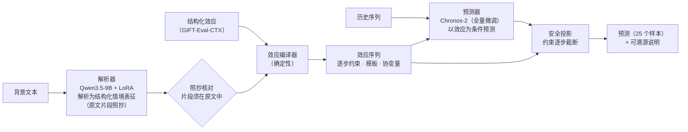
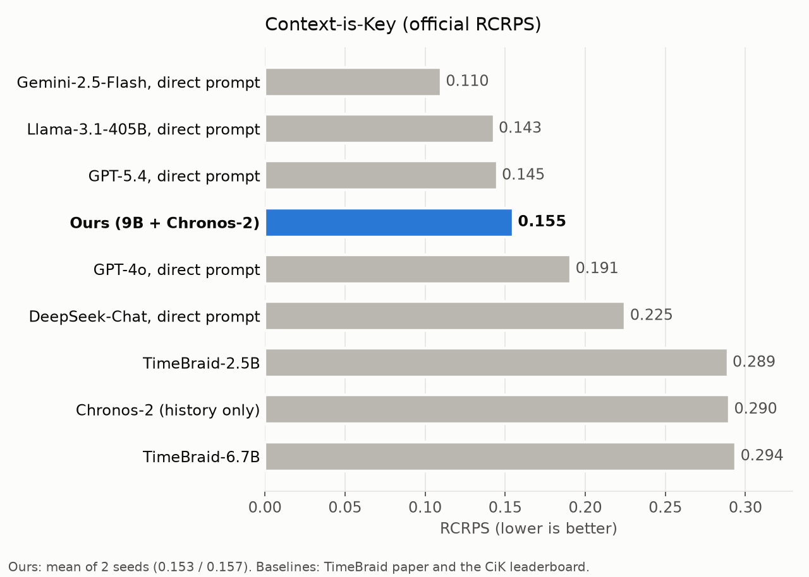

# 用背景文本改进时间序列预测：以结构化情境表征为接口

> **汇报页面：https://caesarrwang.github.io/tsfm_ctx/**（本文件为文字版）
>
> 进展汇报 · 2026-11-26 · 数字均为当前版本；标注“两个种子”的为两次独立训练的结果

---

## 0. 一页摘要

**问题。**时间序列预测常常附带背景文本，例如“下周一门店装修停业”“下午 2 点到 5 点用电量将是平时的 4 倍”。纯时序模型读不懂文本；大模型能读懂，但直接让它输出预测或数值，有计算错误、成本高、不可检查等问题。

**做法。**在文本和预测之间放一层**结构化情境表征**：

1. 一个 9B 语言模型把文本解析成结构化情境表征，原文片段照抄，不自己算数；
2. 一个确定性的编译器把效应变成逐步的约束、模板和协变量序列，并带有**可证明的安全保证**；
3. 一个微调后的时序基础模型（Chronos-2）在这些序列的条件下做预测。预测器的训练**不需要成对的“文本–序列”数据**。

**结果。**

| 基准 | 我们 | 对比 |
|---|---|---|
| GIFT-Eval-CTX（10,000 题，越低越好） | **0.476** | 榜单第一 MoiraiAgent 0.497 · TimeBraid-6.7B 0.773 · Chronos-2 0.795 |
| Context-is-Key（355 题，官方 RCRPS，越低越好） | **0.154** | GPT-5.4 直接提示 0.145 · GPT-4o 0.191 · TimeBraid 0.289–0.294 · Chronos-2 0.290 |

只用 9B 语言模型加一个约 1.2 亿参数的时序模型：在 GIFT-Eval-CTX 上超过基于 GPT-5.6 的智能体；在 Context-is-Key 上接近前沿大模型的直接提示，比 TimeBraid 好约 0.14。

---

## 1. 背景

### 1.1 任务

给定一段序列的历史，以及与之相关的背景信息（文本或结构化描述），预测未来 H 步。评价同时看点预测和概率预测。

### 1.2 两个基准

| | GIFT-Eval-CTX | Context-is-Key |
|---|---|---|
| 规模 | 10,000 道题，78 个“数据集 × 预测长度”组 | 355 道题，71 类任务 |
| 背景信息的形式 | **结构化效应**：趋势、水平范围、季节性（Macro），以及局部偏移、跳变（Micro） | **自然语言文本**：事件、约束、因果关系、外部输入等 |
| 预测长度 | 短期、中期、长期，最长 900 步 | 一般 24–100 步 |
| 指标 | 相对季节性朴素预测的 MASE，按组取几何平均 | RCRPS：概率预测误差，重点区域加权，违反约束会被重罚 |
| 检验的是 | 能否把效应信息用好（预测器） | 能否读懂文本并用好（完整链路） |

### 1.3 现有路线

| 路线 | 代表 | 局限 |
|---|---|---|
| 时序基础模型，只看历史 | Chronos-2、TimesFM、Moirai | 用不上文本 |
| 大模型直接给出预测 | GPT、Gemini、Llama 直接提示 | 依赖前沿大模型；数值由模型生成，过程不可检查 |
| 端到端融合文本和序列 | TimeBraid（1.2B–6.7B） | 需要大规模成对数据；在两个基准上都接近纯历史预测的水平 |
| 智能体调用工具 | MoiraiAgent（GPT-5.6） | 依赖前沿大模型，成本高 |

---

## 2. 动机

| 观察 | 由此得到的设计 |
|---|---|
| 文本里对预测有用的，大多是可以精确表达的“效应”：某段时间等于多少、不超过多少、上升还是下降、外部输入怎么变 | 定义一种**结构化情境表征**，作为文本和预测之间的中间表示 |
| 大模型读文本没问题，但换算时间和数值容易出错（直接输出时，时间对的只有 55%–75%） | 语言模型只**指出**原文片段，换算交给确定性的编译器 |
| 读错的效应会损害预测 | 编译器的约束执行要有**可证明的安全性**：陈述为真时不变差，为假时损失有界 |
| 文本给的信息往往不完整（只有方向、只有极值、只有形状），需要从历史推断其余部分 | 训练一个以效应为条件的时序模型来补全 |
| 成对的“文本–序列”数据稀缺 | 从序列的真实未来中自动提取效应，**自监督**地训练预测器 |

---

## 3. 方法

### 3.1 总体结构



两个基准共用编译器之后的部分：文本前端和结构化前端都编译到同一种结构化情境表征。

### 3.2 结构化情境表征

| 效应 | 例子 | 语义（编译结果） | 执行方式 |
|---|---|---|---|
| 精确值 / 倍数 / 增减 / 百分比 | “平时的 4 倍”“降为零” | 某几步等于 v | 硬约束（可信度为“已确认”时） |
| 范围、上限、下限 | “不超过 6.29” | 某几步落在 [a, b] | 硬约束 |
| 全程水平范围 | Macro 的水平范围 | 所有步落在 [a, b] | 硬约束 |
| 仅方向 | “节假日车流会减少” | 某几步高于或低于平时 | 交给预测器推断幅度 |
| 趋势、季节幅度、反复偏移、季节性 | Macro 的趋势和季节性 | 形状模板 | 交给预测器 |
| **外部输入时间表** | “负载 0.2，从 05:48:01 到 05:48:27”；参考序列；“10 点转晴” | 历史加未来的逐步输入序列 | 交给预测器，由它从历史学习输入和目标的关系 |
| **历史屏蔽** | “每 15 天维护 7 天，未来不再维护” | 历史中的异常时段标为缺失 | 代码执行 |

每条效应还带有可信度（已确认 / 传闻）。传闻只作为提示，不作为硬约束执行。

### 3.3 解析器：文本 → 结构化情境表征

- **模型：**Qwen3.5-9B，加 LoRA 适配器；原模型权重不变，卸下适配器即为原版，对话能力保留。
- **输出：**每条陈述一行，时间和数值必须**照抄原文**。例如：

  ```
  electricity | multiple of usual | fromfor | from 2013-05-28 12:00:00 for 2 hours | 4 | up | sustained | confirmed | no
  input | load | from 05:48:01 until 05:48:27 | 0.2
  exclude | starting from 1996-08-12 00:00:00 | 7 days | every 15 days
  ```
- **核对：**照抄的片段必须能在原文中找到，否则丢弃。换算成第几步、多少数值，由代码完成。
- **训练数据（约 8 万条）：**模板文本；27B 改写的自然文本；CAF-7M 训练集的真实文本，由 27B 标注，并经“换算回去与标注一致”核对后保留；外部输入、参考序列、状态变化、历史屏蔽等合成段落。**不含任何测试文本。**

### 3.4 效应编译与安全投影

编译器把每条效应变成预测轨迹上的数学对象（见 3.2）。预测之后，对已确认的约束做**逐步截断**：区间约束对每个样本截断，精确值把分布的中位数平移到该值。

**理论保证**（证明只需要 CRPS 的定义和三角不等式）：

| | 结论 |
|---|---|
| 定理 1 | 真实值在约束区间内时，截断后 CRPS（和点预测误差）**不会增加** |
| 定理 2 | 真实值在区间外、距离为 d 时，CRPS 最多增加 d；点预测误差不超过 max(截断前误差, d) |
| 命题 3 | 精确值平移：CRPS 最多增加 2 × (陈述值与真实值的差)；陈述准确时不增加 |

含义：代码层是一个可证明的“安全层”，损失只可能来自读错或文本本身不准确。

### 3.5 预测器：以效应为条件的预测

- **模型：**Chronos-2 全量微调。效应序列作为已知的未来协变量输入，共 11 条效应通道和 1 条外部输入通道。
- **训练数据（自监督，不需要文本）：**取 GIFT-Eval 预训练集的真实窗口，不含任何测试数据：
  - 用规则从**真实未来**中提取效应，一半按结构化格式描述，一半按文本格式描述，描述精度分三档：精确值、大致幅度、仅方向；
  - 写入大幅度效应，加入“说了但没发生”的陈述和可信度标签；
  - 约 30% 的窗口加入由人造外部输入驱动的成分：比例、平方、带延迟的关系，以及与目标无关的输入；
  - 短窗口（24–48 步）和长窗口（480 / 720 步）混合训练。
- **训练流程：**短窗口 8000 步 → 加入长窗口和短窗口回放 8000 步 → 加入外部输入 3000 步（最终版本记为 E16）。

### 3.6 推理与可溯源说明

- **混合方案：**有陈述的步用预测器，再做安全投影；没有陈述的步、精确值的步，以原版 Chronos-2 的预测为基础。
- **可溯源说明：**由代码自动生成，不让语言模型自由发挥。例如：

  > **效应 1：平时的倍数**
  > - 原文依据：“…a heat wave in city A from 2013-05-28 12:00:00 for 2 hours, … 4 times the usual electricity being consumed.”
  > - 对应：第 9–10 步（12:00–13:00）；照抄的时间和数值；可信度：已确认
  > - 影响：这几步平时水平平均 519 → 最终预测 2075（+300%）
  >
  > **效应 2：**“…a major dip of 75% … 2 weeks ago” → **已丢弃：陈述的时间不在预测期内**

---

## 4. 实验

### 4.1 设置

- GIFT-Eval-CTX：使用官方数据和榜单的汇总代码；季节周期使用修正后的换算。我们复算了季节性朴素预测、Chronos-2、TimeBraid 的每题 MASE，和公开结果完全一致（10,000 / 10,000）。
- Context-is-Key：使用官方 RCRPS 脚本，每题 25 个样本，按官方任务权重汇总。
- 预测器每个设置训练两个随机种子。

### 4.2 主结果：GIFT-Eval-CTX


| 方法 | 输入 | 总分 | 短期 | 中期 | 长期 |
|---|---|---|---|---|---|
| **我们（E16，种子 0 / 1）** | 历史 + Macro + Micro | **0.478 / 0.474** | 0.401 / 0.395 | 0.594 / 0.587 | 0.539 / 0.541 |
| MoiraiAgent（GPT-5.6 Sol） | 同上 | 0.497 | 0.398 | 0.623 | 0.603 |
| GPT-5.6 Sol | 同上 | 0.565 | 0.417 | 0.727 | 0.782 |
| tabSutra-39M + 规则 | 同上 | 0.627 | 0.538 | 0.719 | 0.729 |
| TimeBraid-6.7B | 同上 | 0.773 | 0.685 | 0.872 | 0.864 |
| Claude Opus 4.8 | 同上 | 0.781 | 0.538 | 1.077 | 1.147 |
| Chronos-2 | 只有历史 | 0.795 | 0.764 | 0.803 | 0.848 |

所有方法使用的输入相同（历史 + Macro + Micro）。

### 4.3 主结果：Context-is-Key



| 方法 | RCRPS |
|---|---|
| Gemini-2.5-Flash 直接提示 | 0.110 |
| Llama-3.1-405B 直接提示 | 0.143 |
| GPT-5.4 直接提示 | 0.145 |
| **我们（种子 0 / 1）** | **0.152 / 0.156** |
| GPT-4o 直接提示 | 0.191 |
| DeepSeek-Chat 直接提示 | 0.225 |
| TimeBraid-2.5B / 6.7B | 0.289 / 0.294 |
| Chronos-2 只看历史 | 0.290 |

方法演进中的关键版本：

| 版本 | RCRPS |
|---|---|
| 27B 改写 + 9B 提取，预测器 E14 | 0.255 |
| 一步式 9B（蒸馏），预测器 E15 | 0.190 |
| + 外部输入、参考序列、历史屏蔽；预测器 E16 | **0.152–0.156** |

### 4.4 预测器的价值

**GIFT-Eval-CTX：同样的效应信息，只用规则 vs 加预测器**

| 做法 | 总分 |
|---|---|
| 只看历史 | 0.795 |
| 只用规则（代码执行约束） | 0.634 |
| 只用预测器（不做投影） | 0.542–0.554 |
| **混合（预测器 + 安全投影）** | **0.474–0.478** |

**GIFT-Eval-CTX：去掉某类信息（混合方案，种子 0 / 1）**

| 设置 | 总分 |
|---|---|
| 全部信息 | 0.478 / 0.474 |
| 去掉趋势 | 0.493 / 0.494 |
| 去掉季节幅度、反复偏移、季节性 | 0.486 / 0.482 |
| 去掉全程水平范围 | 0.547 / 0.537 |
| 只用 Micro | 0.560 / 0.559 |
| 只用 Macro | 0.629 / 0.622 |

**Context-is-Key：输入相同且正确时，外部输入交给谁（RCRPS）**

| 任务 | 只看历史 | 原版 Chronos-2 + 输入 | **预测器 + 输入（种子 0 / 1）** |
|---|---|---|---|
| 因果方程（隐含 / 最少信息） | 0.318 | 0.180 | **0.109 / 0.132** |
| 风扇转速 | 0.460 | 0.427 | **0.316 / 0.311** |
| 风扇压力（只说“亲和定律”） | 0.656 | 0.420 | **0.290 / 0.370** |
| 风扇压力（明确说平方关系） | 0.656 | **0.289** | 0.265 / 0.330 |

端到端（解析器实际读出的结果）：规则 0.165 → 混合 **0.152 / 0.156**。

**Context-is-Key：只给方向时**（对照实验，把读出的数值去掉，只保留方向）：在 ATM 停用、交通量下降、传感器维护三类任务上，预测器把误差降低了 20%–35%，而规则在这种情况下无能为力。

### 4.5 解析器：抽取准确率

Context-is-Key 中有标准答案的 60 道题。端到端使用同一个预测器。

| 解析器 | 找到 | 时间对 | 整段全对 | 找不到依据的数值 | 端到端 RCRPS |
|---|---|---|---|---|---|
| 原版 9B 直接输出 JSON | 65% | 55% | 50% | 2% | 0.261 |
| 27B 直接输出 JSON | 92% | 75% | 72% | 0 | 0.194 |
| **9B 照抄 + 代码换算** | **100%** | **100%** | **98%** | 0（核对拦下 1 行） | **0.190** |

直接输出几乎不编造数值，主要问题是漏读和时间换算错误。照抄加代码换算消除了这两类错误，让 9B 达到并略超 27B 直接输出的水平。表中是外部输入功能加入之前的版本。

### 4.6 安全投影的实证检验

| 基准 | 检验 | 违反次数 |
|---|---|---|
| GIFT-Eval-CTX（225 万个预测步，94.6% 的约束为真） | 真约束下误差变大 / 假约束下超出上界 | **0 / 0** |
| Context-is-Key（25 个样本，逐步 CRPS） | 区间约束、真实值在区间内：CRPS 变大 | **0** / 240 步 |
| | 精确值超出命题 3 的上界 | **0** / 765 步 |

### 4.7 稳健性核查

| 核查 | 结果 |
|---|---|
| 训练数据的部分规则参数曾在 3,000 道测试题上调过；只看另外 7,000 道 | 我们 0.480 / 0.478，MoiraiAgent 0.501，领先依然成立 |
| 趋势判断阈值是否对着测试标注优化过 | 不是：只用 3,000 道题重新搜索，最优取值与现值不同，现值的一致率在两组题上相同 |
| 微调是否损害只看历史的能力 | GIFT-Eval-CTX：0.787，原版 0.795，没有退化；Context-is-Key：0.295–0.303，原版 0.290，轻微退化，推理时没有陈述的步改用原版来规避 |
| “上下界约束”任务的大幅提升是否碰巧 | 逐题核对，5 道题都是正确读出约束 |

---

## 5. 局限与下一步

**局限**

1. **Context-is-Key 存在“看过测试题”的问题。**解析器的若干修正，以及外部输入的训练模板，是看过这些题型之后设计的；预测器版本也是按测试成绩选的。需要一个独立的文本测试集来检验。
2. **常识和类比类的题不在方法范围内**（约占 Context-is-Key 权重的 14%），例如“新区靠近河流，参照其他区估计救援次数”。前沿大模型的优势主要在这里。
3. **在 Context-is-Key 上，预测器的贡献约为 0.01**，比在 GIFT-Eval-CTX 上（0.634 → 0.476）小得多。

**下一步**

| 事项 | 目的 |
|---|---|
| 解析器第四轮训练（进行中） | 修正 ATM 停用、假日交通等题上的退步 |
| 换 TimesFM 底座 | 证明结构化情境表征和训练方法不依赖 Chronos-2 |
| 把 GIFT-Eval-CTX 的结构化效应改写成自然文本 | 得到一个独立、大规模的“文本 → 预测”测试集 |
| 消融实验 | 预测器训练数据的各个成分（假陈述、部分信息、外部输入）、数据规模曲线；照抄 vs 直接计算 |
| 榜单提交 | 待定 |

---

## 附：术语

| 术语 | 含义 |
|---|---|
| 效应 | 文本或结构化信息中关于未来的一条陈述，例如某段时间等于多少、上升还是下降 |
| 结构化情境表征 | 效应的形式化表示，每种效应对应预测轨迹上的一个数学对象 |
| 安全投影 | 预测后把已确认的约束逐步截断 |
| 混合方案 | 预测器 + 安全投影，没有陈述的步沿用原版模型 |
| E14 / E15 / E16 | 预测器的训练版本；E16 为当前定稿 |
| RCRPS | Context-is-Key 的官方指标：加权的概率预测误差，违反约束有额外惩罚 |
