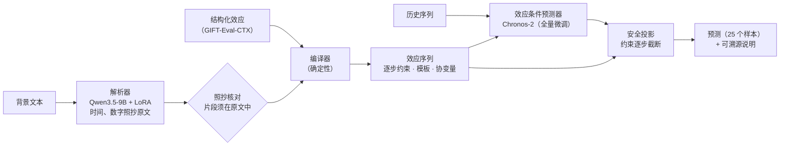
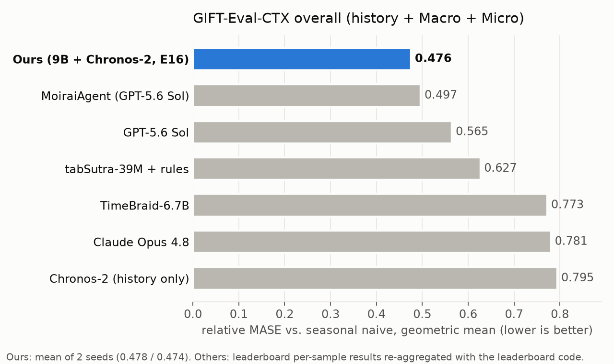

# 用背景文本改进时间序列预测：以结构化情境表征为接口

> **汇报页面：** [https://caesarrwang.github.io/tsfm_ctx/](https://caesarrwang.github.io/tsfm_ctx/)（本文件为文字版，结构与页面一致；示例、图表的交互版本见页面）
>
> 进展汇报 · 2026-11-26 · 数字均为当前版本；“两个种子”指预测器的两次独立训练

---

## 摘要

时间序列预测常常附带背景文本，例如“下周一门店装修停业”“下午 2 点到 5 点用电量将是平时的 4 倍”。这些信息不在历史数据里，却直接决定了未来。现有模型要么读不了背景（时序基础模型），要么读了却几乎没用上（端到端多模态模型），要么用上了但数值预测能力差、依赖前沿大模型（大模型直接预测）。

我们提出以**结构化情境表征**为接口，把文本上下文转化为**显式的未来时间效应**，从而增强时序基础模型的预测：

1. **解析器**（Qwen3.5-9B + LoRA）把文本解析成结构化情境表征，时间和数字照抄原文，不自己计算；
2. **编译器**（确定性程序）把每条效应换算成逐步的效应序列和约束，并带有**可证明的安全保证**；
3. **效应条件预测器**（微调的 Chronos-2）以这些序列为条件做预测，补全文本没说清的部分。它的训练**不需要成对的“文本–序列”数据**。

| 基准 | 我们 | 对比 |
|---|---|---|
| GIFT-Eval-CTX（10,000 题，越低越好） | **0.476** | 榜单第一 MoiraiAgent 0.497 · TimeBraid-6.7B 0.773 · Chronos-2 0.795 |
| Context-is-Key（355 题，官方 RCRPS，越低越好） | **0.154** | GPT-5.4 直接提示 0.145 · GPT-4o 0.191 · TimeBraid 0.289–0.294 · Chronos-2 0.290 |

只用 9B 语言模型加一个约 1.2 亿参数的时序模型，在 GIFT-Eval-CTX 上超过基于 GPT-5.6 的智能体，在 Context-is-Key 上接近前沿大模型的直接提示，比 TimeBraid 好约 0.14。安全投影的实证检验中违反 0 次。

---

## 1. Introduction

### 1.1 现有模型真的在利用背景信息吗？

最直接的检验，是比较同一个方法**给背景**和**不给背景**时的成绩。GIFT-Eval-CTX 的背景都来自真实未来，保证有用，最适合做这个检验（相对 MASE，越低越好，1.0 = 季节性朴素预测）。

| 方法 | 类型 | 不给背景 | 给背景 | 判断 |
|---|---|---|---|---|
| Chronos-2 / Moirai-2 | 时序基础模型 | 0.78–0.80 | — | 没有接收背景的通道 |
| TimeBraid-6.7B | 端到端文本–时序 | ≈0.79* | 0.773 | 几乎没用上 |
| Claude Opus 4.8 | 大模型直接预测 | 1.109 | 0.781 | 用上了，但仍不如只看历史的时序模型 |
| GPT-5.6 Sol | 大模型直接预测 | 0.953 | 0.565 | 用上了，依赖前沿模型 |

\* TimeBraid 没有公开只看历史的成绩，用同类只看历史的时序基础模型（0.78–0.80）作参照。Context-is-Key 上也一样：TimeBraid 0.289–0.294，只看历史的 Chronos-2 0.290。

- **发现 1：端到端和融合式模型几乎没用上背景。**TimeBraid 在两个基准上都与只看历史的时序模型持平。
- **发现 2：大模型用上了，但不擅长数值。**不给背景时比季节性朴素还差；给了背景，Claude 在中期和长期仍是 1.08 / 1.15。
- **发现 3：时序模型会预测，却读不了背景。**Chronos-2 等只看历史就有 0.78–0.80，但没有接收文本或效应的通道。

**文献中的同样发现**

- **Semantics or Structure? Auditing Text Sensitivity in Multimodal Time-Series Forecasting**（Sridhar et al., ICML 2026 Workshop, arXiv 2608.22321）：Aurora、MM-TSFlib、TaTS 在 Time-MMD 上，把文本换成空文本、固定文本、打乱或其他领域的文本，MSE 变化都小于 0.5%。报告的提升来自随文本提供的一列数值 `prior_history_avg`：构建数据集时让大模型根据该行之前的历史给出的数值预测（与滑动平均高度相关），被直接混入模型输出（TaTS 中占一半权重），而不是文本内容。
- **Does Text Actually Help? Uncovering and Resolving Text Collapse in Multimodal Time Series Forecasting**（Nguyen et al., arXiv 2606.19413）：融合式模型的文本分支“坍缩”成与输入无关的输出，原因是数值历史与未来高度自相关，数值分支占主导。

对我们的启发：不要指望模型自己去“注意”文本。把文本转成显式的未来效应，作为逐步的输入和约束直接交给时序模型，它就无法忽略。

**缺口：**没有一种方法能**既用上背景，又保住时序基础模型的数值预测能力**。

### 1.2 理想的上下文感知时序模型应该是什么样的？

| 要求 | 含义 |
|---|---|
| R1 没有上下文时不退化 | 没有文本或文本无关时，保持时序基础模型原有的预测能力 |
| R2 有上下文时确实提升 | 信息越具体（精确数值 > 大致幅度 > 只给方向），提升越大 |
| R3 提升来自文本内容 | 改变或去掉文本，预测随之改变；干扰句不改变预测；不能靠额外数值或模型集成 |
| R4 时间对齐 | 陈述作用到预测期中正确的时间步 |
| R5 对错误信息稳健 | 读错或文本有误时损失有界；可信度低的信息打折扣 |
| R6 可溯源 | 能说清预测的哪一段因文本中的哪一句而改变 |
| R7 代价可接受 | 不依赖前沿大模型和大规模成对数据 |

| 方法类别 | R1 | R2 | R3 | R4 | R5 | R6 | R7 |
|---|---|---|---|---|---|---|---|
| 时序基础模型 | ✓ | ✗ | — | — | — | — | ✓ |
| 融合式 / 端到端多模态（TaTS、MM-TSFlib、TimeBraid） | ? | ✗ | ✗ | ? | ✗ | ✗ | △ |
| 大模型直接预测 | ✗ | ✓ | ✓ | △ | ✗ | ✗ | ✗ |
| 智能体（MoiraiAgent） | ? | ✓ | ✓ | ? | ✗ | △ | ✗ |
| **本文** | ✓ | ✓ | ✓ | ✓ | ✓ | ✓ | ✓ |

✓ 满足 · △ 部分满足 · ✗ 不满足 · ? 未见公开证据。

<details>
<summary>本文如何满足这些要求（证据）</summary>

- **R1：**没有读出任何效应时，直接使用原版 Chronos-2 的预测；预测器本身只看历史时，GIFT-Eval-CTX 0.787（原版 0.795）。
- **R2：**GIFT-Eval-CTX 0.795 → 0.476，Context-is-Key 0.290 → 0.152；早期版本的分档实验中，精确数值 0.53、大致幅度 0.55、只给方向 0.68、不给 0.79。
- **R3：**用电量任务的 7 个变体（含干扰句、拆分叙述、长短新闻）得分完全相同（0.003）；因果混淆任务中的无关陈述没有被读出；没有额外的数值输入或模型集成。
- **R4：**60 道有答案的题中，时间全部对齐（大模型直接输出为 55%–75%）。
- **R5：**定理 1–3；早期实验中，假陈述覆盖的步上，完全照做误差 1.6、完全不理 0.43，标为传闻时 0.91–0.96。
- **R6：**自动生成的预测说明，每处修改都对应原文中的一句话（见 3.6）。
- **R7：**解析器 9B，预测器 0.12B；预测器的训练不需要任何文本。

</details>

### 1.3 关键观察：背景一旦变成“显式的未来时间效应”，时序模型就能用上

不训练任何模型，只把 GIFT-Eval-CTX 的背景换算成预测期内逐步的约束，再套到原版 Chronos-2 的预测上：

| 做法 | GIFT-Eval-CTX |
|---|---|
| Chronos-2，只看历史 | 0.795 |
| TimeBraid-6.7B（端到端，读背景） | 0.773 |
| Claude Opus 4.8（读背景） | 0.781 |
| Chronos-2 + 背景换算成的逐步约束（不训练） | 0.634 |
| + 学会理解这些效应的预测器（本文） | **0.476** |

瓶颈在背景和时序模型之间的**接口**。这就是我们提出结构化情境表征的原因。

### 1.4 我们的做法



| 观察 | 设计 |
|---|---|
| 大模型读文本没问题，但换算时间和数值容易出错 | 语言模型只**指出**原文片段，换算交给编译器 |
| 读错的效应会损害预测 | 约束执行带**可证明的安全性**：真陈述不变差，假陈述损失有界 |
| 文本信息常常不完整：只有方向、形状、极值或外部输入 | 训练**以效应为条件**的时序模型，从历史中补全 |
| 成对的“文本–序列”数据稀缺 | 从真实序列的未来中提取效应，**自监督**训练 |

### 1.5 贡献

1. **结构化情境表征与安全保证：**文本和结构化信息编译到同一种带形式语义的中间表示；陈述为真时约束投影不增加 CRPS，为假时增加量不超过陈述的偏差，实证违反 0 次。
2. **不需要成对数据的训练：**从真实序列的未来中提取效应，加入“说了但没发生”的陈述、不同精度的描述和人造外部输入，自监督地训练效应条件预测器。
3. **小模型、强结果、可溯源：**9B + 0.12B 在 GIFT-Eval-CTX 上超过基于 GPT-5.6 的榜单第一（0.476 对 0.497），在 Context-is-Key 上比 TimeBraid 好约 0.14；每个效应都能追溯到原文句子。

---

## 2. Related Work

| 研究线 | 代表工作 | 与本文的区别 |
|---|---|---|
| 时序基础模型 | Chronos / Chronos-2、TimesFM、Moirai、Toto | 不改模型结构，而是给它一种从文本得到协变量的方式，并训练它理解这些协变量 |
| 用语言模型做预测 | LLMTime、Time-LLM；Context-is-Key 上的前沿大模型直接提示 | 不让语言模型生成任何预测数值，只让它解析文本 |
| 文本–序列多模态模型与智能体 | TimeBraid、CAF-7M、MoiraiAgent | 预测器不需要成对文本；中间表示可检查且有理论保证；不依赖前沿大模型 |
| 语义解析与程序辅助推理 | PAL、Toolformer 一类工作 | 为预测设计了专门的结构化情境表征，并给出它在 CRPS 下的安全性质 |
| 多模态时序模型是否用上文本 | Semantics or Structure?（2608.22321）；Does Text Actually Help?（2606.19413，提出 REST-TS）；When Does Multimodality Lead to Better TSF?（2506.21611） | 这些工作诊断或修补模型内部的融合；我们绕开融合，把文本转成显式的未来时间效应 |

| 路线 | 代表 | 用文本 | 不需要成对数据 | 过程可检查 | 理论保证 | 模型规模 |
|---|---|---|---|---|---|---|
| 时序基础模型 | Chronos-2、TimesFM、Moirai | — | ✓ | — | — | 小 |
| 大模型直接预测 | GPT、Gemini、Llama | ✓ | ✓ | — | — | 前沿大模型 |
| 端到端多模态 | TimeBraid | ✓ | — | — | — | 1.2B–6.7B |
| 智能体 | MoiraiAgent | ✓ | ✓ | 部分 | — | 前沿大模型 |
| **本文** | 结构化情境表征 | ✓ | ✓（预测器） | ✓ | ✓ | 9B + 0.12B |

---

## 3. Method

### 3.1 问题定义

给定历史 y₁:T 和背景信息 c（文本或结构化效应），预测未来 y_{T+1:T+H} 的分布：

```
E      = Parse(c)              # 结构化情境表征（解析器，学习）
(Z, 𝒞) = Compile(E, y_1:T)     # 效应序列 Z ∈ ℝ^{H×12}，约束 𝒞_t = [a_t, b_t]（编译器，确定性）
F      = p_θ(· | y_1:T, Z)     # 效应条件预测器（学习）
F′     = Π_𝒞(F)                # 安全投影（确定性）
```

GIFT-Eval-CTX 的结构化效应不需要解析器，直接进入编译器。

### 3.2 结构化情境表征

| 效应 | 例子 | 语义（编译结果） | 执行方式 |
|---|---|---|---|
| 精确值 / 倍数 / 增减 / 百分比 | “平时的 4 倍”“降为零” | 某几步等于 v | 硬约束（已确认时） |
| 范围、上限、下限 | “不超过 6.29” | 某几步落在 [a, b] | 硬约束 |
| 全程水平范围 | Macro 的水平范围 | 所有步落在 [a, b] | 硬约束 |
| 仅方向 | “节假日车流会减少” | 某几步高于或低于平时 | 预测器推断幅度 |
| 趋势、季节幅度、反复偏移、季节性 | Macro 的趋势和季节性 | 形状模板 | 预测器 |
| 外部输入时间表 | “负载 0.2，从 05:48:01 到 05:48:27”；参考序列；“10 点转晴” | 历史加未来的逐步输入序列 | 预测器学习输入与目标的关系 |
| 历史屏蔽 | “每 15 天维护 7 天，未来不再维护” | 历史中的异常时段标为缺失 | 程序 |

每条效应带有可信度（已确认 / 传闻）。传闻只作为提示，不作为硬约束执行。

### 3.3 解析器：文本 → 结构化情境表征

- **模型：**Qwen3.5-9B + LoRA；原模型权重不变，对话能力保留。
- **分工：**模型只负责读懂原文、指出相关片段：类型、方向是理解后选择的，**时间和数字照抄原文**；换算成第几步、多少数值由代码完成。照抄的片段在原文中找不到，这一行就被丢弃。
- **训练数据（约 8 万条，不含任何测试文本）：**模板文本；27B 改写的自然文本；CAF-7M 训练集的真实文本，由 27B 标注，经“换算回去与标注一致”核对后保留；外部输入、参考序列、状态变化、历史屏蔽的合成段落。

**例子（Context-is-Key 真实题目，第四轮解析器的实际输出）**

原文：

> …Suppose that there is a heat wave in city A **from 2013-05-28 12:00 for 2 hours**, leading to excessive use of air conditioning, and **4** times the usual electricity being consumed. A brief technical issue in the electricity grid caused a major dip of **75**% in electricity consumption **2 weeks ago**. This issue is not expected to happen again this week.

模型的输入还包括“预测起点 2013-05-28 03:00，每小时一步，预测 24 步”（由代码从数据的时间戳取得）。模型输出：

```
NAME: electricity consumption
electricity consumption | multiple of usual | fromfor | from 2013-05-28 12:00 for 2 hours | 4 | - | sustained | confirmed | no
electricity consumption | change by percent | past | 2 weeks ago | 75 | down | sustained | confirmed | no
```

代码处理：

| 行 | 照抄核对 | 时间 → 预测步 | 结果 |
|---|---|---|---|
| 第 1 行 | 时间、数字都在原文中 ✓ | 12:00 − 起点 03:00 = 9 小时 → 第 9 步；for 2 hours → 第 9–10 步 | 采用：第 9–10 步 = 平时的 4 倍（↑），已确认 |
| 第 2 行 | ✓ | “2 weeks ago” 在预测起点之前 | 不进入预测：这是历史上的事件 |

其他例子（页面上可切换查看）：

- “7 月 4 日是节假日，交通量会减少”：照抄 `2024-07-04`，结合起点换算成第 1–24 步，只记方向 ↓，不写数值；
- 外部输入时间表：6 段取值，前 3 段落在历史，后 3 段落在预测期第 1–16、17–18、19–32 步，拼成逐日输入序列；
- 被丢弃的一行：模型把“最大日照的平均时刻 12:25:33”当成外部输入，数值“12:25:33”不是数字，代码核对不通过，这一行被丢弃。

### 3.4 编译器与安全投影

**编译：每条效应 → 逐步效应序列。**编译器把一条效应写到预测期的对应时间步上：说到的步写入数值，没说到的步留空。结果是 12 条与预测期等长的序列（通道）：

| 通道 | 含义 |
|---|---|
| lo / hi | 下界 / 上界（相等即精确值） |
| dir / conf | 方向 / 可信度 |
| glo / ghi | 全程下界 / 上界 |
| trend | 趋势模板 |
| samp | 季节幅度 |
| rec / recv | 反复偏移的方向 / 水平 |
| seas | 季节性 |
| inp | 外部输入 |

| 例子 | 编译结果 |
|---|---|
| 精确倍数（用电量） | 第 9–10 步：lo = hi = 平时水平 × 4 = 2199、1951，dir = ↑，conf = 1；其余步、其余通道留空。“平时水平”是原版 Chronos-2 只看历史时对这两步的预测（约 550 和 488） |
| 只给方向（节假日） | 第 1–24 步：dir = ↓，conf = 1；上下界不写，降多少由预测器根据历史推断；第 25–72 步留空 |
| 外部输入（因果方程） | 只有 inp 通道：第 1–16 步 0.055，第 17–18 步 0.111，第 19–32 步 0.133；目标与输入的系数由预测器从历史中估计 |
| 结构化效应（GIFT-Eval-CTX） | glo / ghi 写满全程（0.9 / 20.35）；trend 为先升后降的模板；seas = 0.5（不规则）；三次偏移只写在对应步：第 11–14 步 ↑（hi 18.4）、第 19–20 步 ↓（lo 10.75）、第 28–36 步 ↑（hi 20.35） |

**安全投影。**预测之后，对已确认的约束做逐步截断：区间约束对每个样本截断，精确值把分布的中位数平移到该值、离散程度不变。理论保证（只需要 CRPS 的定义和三角不等式）：

| | 结论 |
|---|---|
| 定理 1 | 真实值在约束区间内时，截断后 CRPS（和点预测误差）**不会增加** |
| 定理 2 | 真实值在区间外、距离为 d 时，CRPS 最多增加 d |
| 命题 3 | 精确值平移：CRPS 最多增加 2 × (陈述值与真实值的差)；陈述准确时不增加 |

### 3.5 效应条件预测器与自监督训练

**效应序列如何进入预测器。**Chronos-2 原生支持已知的未来协变量。我们把 12 条通道作为这样的协变量；关键在于历史部分的填法：每条通道的历史部分都用真实历史按同样的含义填充，模型在历史上能看到“通道里的值”与“目标的实际值”怎样对应，再据此读懂未来部分写入的效应。

| 序列 | 历史部分 | 未来部分 |
|---|---|---|
| 目标序列 | 历史真实值 | 要预测 |
| lo / hi | = 历史真实值 | 精确值、范围、上下限 |
| dir / conf | 历史中相对平时水平的方向及其强度 | 陈述的方向、可信度 |
| glo / ghi | = 历史真实值 | 全程水平范围 |
| trend | 平滑后的历史（按极差归一） | 趋势模板 |
| samp | 历史每个周期的峰谷幅度 | 季节幅度 |
| rec / recv | 历史中的偏移方向 / 历史真实值 | 反复偏移的方向 / 水平 |
| seas | = 1 | 季节性：延续 / 不规则 / 无 |
| inp | 文本给出的历史段输入值 | 文本给出的未来段输入值 |

流程：输入 → Chronos-2（全量微调；目标与各通道作为同一组变量，组内注意力交换信息）→ 每步 21 个分位数 → 25 个样本 → 安全投影。原版 Chronos-2 不知道这些通道的含义，微调让它学会，例如“dir = −1 但 lo / hi 留空”意味着要从历史推断下降幅度。

**训练数据（自监督，不需要文本）：**取 GIFT-Eval 预训练集的真实窗口，不含任何测试数据：

- 用规则从**真实未来**中提取效应，描述精度分三档：精确值、大致幅度、仅方向；
- 加入“说了但没发生”的陈述和可信度标签；
- 约 30% 的窗口加入由人造外部输入驱动的成分：比例、平方、带延迟的关系，以及与目标无关的输入；
- 短窗口（24–48 步）和长窗口（480 / 720 步）混合训练。

训练流程：短窗口 8000 步 → 加入长窗口和短窗口回放 8000 步 → 加入外部输入 3000 步（最终版本 E16）。

### 3.6 推理与可溯源说明

- **混合方案：**有陈述的步用预测器，再做安全投影；没有陈述的步、精确值的步，以原版 Chronos-2 的预测为基础。
- **可溯源说明：**由代码自动生成。例如：

  > **效应 1：平时的倍数**
  > - 原文依据：“…a heat wave in city A from 2013-05-28 12:00:00 for 2 hours, … 4 times the usual electricity being consumed.”
  > - 对应：第 9–10 步（12:00–13:00）；照抄的时间和数值；可信度：已确认
  > - 影响：这几步平时水平平均 519 → 最终预测 2075（+300%）
  >
  > **效应 2：**“…a major dip of 75% … 2 weeks ago” → **不进入预测：陈述的时间不在预测期内**

### 3.7 完整示例

页面 3.7 节给出 7 个完整示例（Context-is-Key 真实题目 + 一道随机抽取的 GIFT-Eval-CTX 题）：原文 → 解析器输出 → 编译出的逐步效应序列 → 原版 Chronos-2 与本文的预测对比。

---

## 4. Experiments

### 4.1 设置

- GIFT-Eval-CTX：使用官方数据和榜单的汇总代码；季节周期使用修正后的换算。我们复算了季节性朴素预测、Chronos-2、TimeBraid 的每题 MASE，和公开结果完全一致（10,000 / 10,000）。
- Context-is-Key：使用官方 RCRPS 脚本，每题 25 个样本，按官方任务权重汇总。
- 预测器每个设置训练两个随机种子。

### 4.2 主结果：GIFT-Eval-CTX



| 方法 | 输入 | 总分 | 短期 | 中期 | 长期 |
|---|---|---|---|---|---|
| **我们（E16，种子 0 / 1）** | 历史 + Macro + Micro | **0.478 / 0.474** | 0.401 / 0.395 | 0.594 / 0.587 | 0.539 / 0.541 |
| MoiraiAgent（GPT-5.6 Sol） | 同上 | 0.497 | 0.398 | 0.623 | 0.603 |
| GPT-5.6 Sol | 同上 | 0.565 | 0.417 | 0.727 | 0.782 |
| tabSutra-39M + 规则 | 同上 | 0.627 | 0.538 | 0.719 | 0.729 |
| TimeBraid-6.7B | 同上 | 0.773 | 0.685 | 0.872 | 0.864 |
| Claude Opus 4.8 | 同上 | 0.781 | 0.538 | 1.077 | 1.147 |
| Chronos-2 | 只有历史 | 0.795 | 0.764 | 0.803 | 0.848 |

### 4.3 主结果：Context-is-Key


| 方法 | RCRPS |
|---|---|
| Gemini-2.5-Flash 直接提示 | 0.110 |
| Llama-3.1-405B 直接提示 | 0.143 |
| GPT-5.4 直接提示 | 0.145 |
| **我们（种子 0 / 1）** | **0.152 / 0.156** |
| GPT-4o 直接提示 | 0.191 |
| DeepSeek-Chat 直接提示 | 0.225 |
| TimeBraid-2.5B / 6.7B | 0.289 / 0.294 |
| Chronos-2 只看历史 | 0.290 |

| 版本 | RCRPS |
|---|---|
| 27B 改写 + 9B 提取，预测器 E14 | 0.255 |
| 一步式 9B，预测器 E15 | 0.190 |
| + 外部输入、参考序列、历史屏蔽；预测器 E16 | **0.152–0.156** |

### 4.4 预测器的价值

**GIFT-Eval-CTX：同样的效应信息，只用规则 vs 加预测器**

| 做法 | 总分 |
|---|---|
| 只看历史 | 0.795 |
| 只用规则（代码执行约束） | 0.634 |
| 只用预测器（不做投影） | 0.542–0.554 |
| **混合（预测器 + 安全投影）** | **0.474–0.478** |

**GIFT-Eval-CTX：去掉某类信息（混合方案，种子 0 / 1）**

| 设置 | 总分 |
|---|---|
| 全部信息 | 0.478 / 0.474 |
| 去掉趋势 | 0.493 / 0.494 |
| 去掉季节幅度、反复偏移、季节性 | 0.486 / 0.482 |
| 去掉全程水平范围 | 0.547 / 0.537 |
| 只用 Micro | 0.560 / 0.559 |
| 只用 Macro | 0.629 / 0.622 |

**Context-is-Key：输入相同且正确时，外部输入交给谁（RCRPS）**

| 任务 | 只看历史 | 原版 Chronos-2 + 输入 | **预测器 + 输入（种子 0 / 1）** |
|---|---|---|---|
| 因果方程（隐含 / 最少信息） | 0.318 | 0.180 | **0.109 / 0.132** |
| 风扇转速 | 0.460 | 0.427 | **0.316 / 0.311** |
| 风扇压力（只说“亲和定律”） | 0.656 | 0.420 | **0.290 / 0.370** |
| 风扇压力（明确说平方关系） | 0.656 | **0.289** | 0.265 / 0.330 |

端到端（解析器实际读出的结果）：规则 0.165 → 混合 **0.152 / 0.156**。

**只给方向时**（对照实验，把读出的数值去掉，只保留方向）：在 ATM 停用、交通量下降、传感器维护三类任务上，预测器把误差降低了 20%–35%，而规则在这种情况下无能为力。

### 4.5 解析器：抽取准确率

Context-is-Key 中有标准答案的 60 道题，端到端使用同一个预测器。

| 解析器 | 找到 | 时间对 | 整段全对 | 找不到依据的数值 | 端到端 RCRPS |
|---|---|---|---|---|---|
| 原版 9B 直接输出 JSON | 65% | 55% | 50% | 2% | 0.261 |
| 27B 直接输出 JSON | 92% | 75% | 72% | 0 | 0.194 |
| **9B 照抄 + 代码换算** | **100%** | **100%** | **98%** | 0（核对拦下 1 行） | **0.190** |

直接输出几乎不编造数值，主要问题是漏读和时间换算错误；照抄加代码换算消除了这两类错误。表中是外部输入功能加入之前的版本。

### 4.6 安全投影的实证检验

| 基准 | 检验 | 违反次数 |
|---|---|---|
| GIFT-Eval-CTX（225 万个预测步，94.6% 的约束为真） | 真约束下误差变大 / 假约束下超出上界 | **0 / 0** |
| Context-is-Key（25 个样本，逐步 CRPS） | 区间约束、真实值在区间内：CRPS 变大 | **0** / 240 步 |
| | 精确值超出命题 3 的上界 | **0** / 765 步 |

### 4.7 稳健性核查

| 核查 | 结果 |
|---|---|
| 训练数据的部分规则参数曾在 3,000 道测试题上调过；只看另外 7,000 道 | 我们 0.480 / 0.478，MoiraiAgent 0.501，领先依然成立 |
| 趋势判断阈值是否对着测试标注优化过 | 不是：只用 3,000 道题重新搜索，最优取值与现值不同，现值的一致率在两组题上相同 |
| 微调是否损害只看历史的能力 | GIFT-Eval-CTX：0.787，原版 0.795，没有退化；Context-is-Key：0.295–0.303，原版 0.290，轻微退化，推理时没有陈述的步改用原版来规避 |
| “上下界约束”任务的大幅提升是否碰巧 | 逐题核对，5 道题都是正确读出约束 |

---

## 5. Conclusion

我们提出以结构化情境表征为接口、把文本信息用于时间序列预测的框架：语言模型只负责把文本解析成效应，编译器以可证明安全的方式执行其中的约束，效应条件预测器从历史中补全文本没说清的部分。它不需要成对的文本–序列数据，只用 9B 语言模型加 0.12B 时序模型，就在 GIFT-Eval-CTX 上超过了基于前沿大模型的智能体，在 Context-is-Key 上接近前沿大模型的直接提示，而且每一处修改都能追溯到原文。

**下一步**

| 事项 | 目的 | 状态 |
|---|---|---|
| 独立的文本测试集 | 解析器已在第四轮冻结；改用独立测试集衡量泛化 | 下一步 |
| 换 TimesFM 底座 | 证明结构化情境表征和训练方法不依赖 Chronos-2 | 计划 |
| 把 GIFT-Eval-CTX 的结构化效应改写成自然文本 | 得到独立、大规模的“文本 → 预测”测试集 | 计划 |
| 消融实验 | 预测器训练数据的各个成分、数据规模曲线；照抄 vs 直接计算 | 计划 |
| GIFT-Eval-CTX 榜单提交 | 第三方认可的成绩 | 待定 |

---

## 附：术语

| 术语 | 含义 |
|---|---|
| 效应 | 文本或结构化信息中关于未来的一条陈述，例如某段时间等于多少、上升还是下降 |
| 结构化情境表征 | 效应的形式化表示，每种效应对应预测轨迹上的一个数学对象 |
| 效应序列（通道） | 编译器把效应写到预测期各时间步上得到的序列，共 12 条 |
| 安全投影 | 预测后把已确认的约束逐步截断 |
| 混合方案 | 预测器 + 安全投影，没有陈述的步沿用原版模型 |
| E14 / E15 / E16 | 预测器的训练版本；E16 为当前定稿 |
| RCRPS | Context-is-Key 的官方指标：加权的概率预测误差，违反约束有额外惩罚 |
